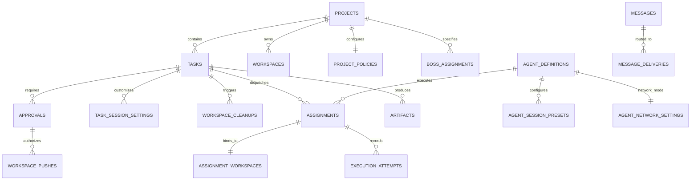
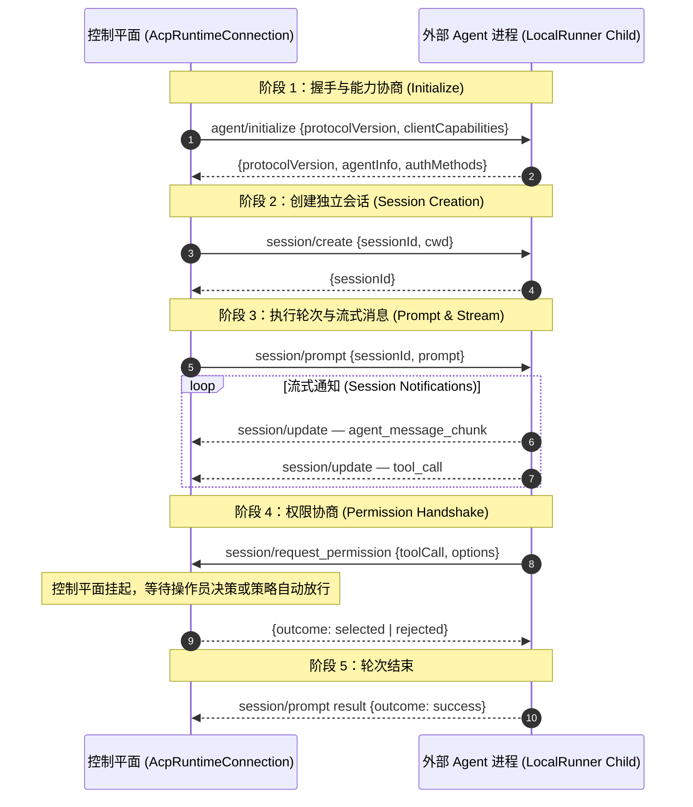
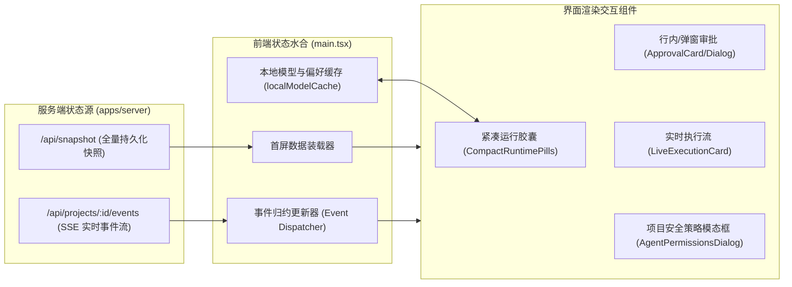

# Multi-Agent Control Plane — 技术架构参考手册

> 本文档为 [AGENTS.md](./AGENTS.md) 的技术配套参考，面向开发者与系统架构师。  
> 涵盖：架构不变量代码映射、数据存储内核、协议生命周期、关键子系统实现、前端水合架构、优化路线图与模块目录索引。

---

## 1. 架构不变量映射矩阵

`AGENTS.md` 规定的 11 条架构不变量约束了所有模块边界与核心决策。重构或新增特性前，必须对照下表检查是否违背：

| # | 不变量 | 规范要求 | 代码落地位置 | 违背后果 |
| :- | :--- | :--- | :--- | :--- |
| 1 | **Agent 与角色分离** | Agent 仅为能力个体，Boss/Worker 是运行时分配的职责 | `packages/core/src/index.ts` — `AgentDefinition` 与 `Assignment` 分离；`bossAssignments` 为独立关联表 | 丧失多 Agent 动态互换角色的灵活性 |
| 2 | **Boss 厂商中立** | 任意合规 Agent 均可当选为 Boss | `apps/server/src/runtime-composition.ts` — 仅要求项目配置 `defaultBossAgentId` | 与厂商专属字段绑定将无法接入私有开源模型 |
| 3 | **ACP 基础传输** | ACP 作为 V0 唯一通信协议 | `packages/acp-runtime/src/runtime.ts` — 封装标准 ndjson 双向流通信 | 使用非标准私有 RPC 破坏模型生态适配能力 |
| 4 | **通信必须中介与审计** | Agent 间严禁直连，流量经由控制平面代理 | `packages/fleet-mcp/src/index.ts` — Fleet MCP 网关通过 `GrantStore` 发放受限 Token 并记录审计事件 | 绕过中介导致 Agent 动作失控、无法追踪因果责任 |
| 5 | **任务状态耐久独立** | 任务状态持久化，与 ACP 进程/会话完全解耦 | `packages/task-engine/src/index.ts` — 状态落盘在 SQLite `tasks` 表；进程崩溃后可无缝重启重试 | 依赖进程内存状态导致崩溃时任务丢失 |
| 6 | **认证凭据完全自治** | 鉴权由 Agent 自身环境管理，禁止将 Token 存入任务载荷 | `packages/core/src/sensitive-text.ts` — 严格脱敏正则，禁止在任务负载持久化 API 密钥 | 凭据明文下发导致泄漏与越权滥用 |
| 7 | **大数据制品化传递** | 超大输出（Diff/日志/文件）作为 Artifact 流转，消息中仅传递引用 | `packages/artifact-store/src/index.ts` — 存储于文件系统并校验 SHA-256 | 内联超大内容导致 SQLite 膨胀、管道拥塞与内存溢出 |
| 8 | **策略权威性裁定** | 策略是控制平面中介操作的最高权威 | `apps/server/src/agent-permission-policy.ts` — 明确标注 `enforced`、`cooperative`、`unavailable` 边界 | 虚标沙箱拦截使操作员产生误判 |
| 9 | **接口驱动持久层** | 本地 SQLite 必须置于 Repository 接口之后 | `packages/storage/src/repositories.ts` — 定义完整接口规范 | 直连 SQLite 语句导致后续迁移至集群数据库时全面重写 |
| 10 | **核心去外部依赖** | OpenHands 等第三方仅作为可选适配器 | 核心调度仅在 `@control-plane/*` 内部闭环 | 耦合外部复杂库使轻量化与单文件交付愿景破产 |
| 11 | **本地沙箱非绝对** | `LocalRunner` 与 Worktree 不等于 OS 内核安全沙箱 | 界面与文档均有显式风险警示，命令执行需要人工二次确认 | 盲信工作目录隔离导致命令执行越权破坏宿主机 |

---

## 2. 数据架构与存储层实现

系统采用 **SQLite 3.53+ (WAL Mode) + Drizzle ORM + Zod 运行时验证** 构筑耐久化底座。  
Schema 定义：`packages/storage/src/schema.ts`

### 2.1 核心实体关系图



### 2.2 表结构与索引设计准则

**混合存储模式 (Hybrid Schema Pattern)**：每张核心表具备强类型查询键（`id`、`projectId`、`taskId`、`state`、`updatedAt`）与统一的 `payload` (JSON) 字段。既能通过 SQLite 原生 B-Tree 索引保障高频状态筛选性能，又使领域模型在扩展时避免频繁 DDL 锁表操作。

**关键表与高频索引**：

- **`tasks`**
  - 主键：`id`（格式：`task-<uuid>`）
  - 联合索引 `tasks_project_state_idx (project_id, state)` → 高速拉取特定项目未完结任务
  - 索引 `tasks_parent_idx (parent_task_id)` → 支持多级子任务 DAG 树遍历

- **`approvals`**
  - 主键：`id`（格式：`appr-<uuid>`）
  - 联合索引 `approvals_project_state_idx (project_id, state)` → 快速拉取待确认审批单
  - 联合索引 `approvals_project_pending_time_idx (project_id, state, requested_at)` → 超时巡检与自动失效

- **`messages` & `message_deliveries`**
  - 唯一联合索引 `messages_idempotency_unique_idx (project_id, from_agent_id, idempotency_key)` → **防重**：Agent 重连时消息绝不重复投递
  - 复合索引 `message_deliveries_recipient_state_idx (recipient_agent_id, state, available_at)` → 批量租约（Lease）抓取

- **`events`（全局审计事件流）**
  - `events_project_sequence_idx` 与 `events_project_task_time_idx` → 基于 `json_extract(payload, '$.taskId')` 表达式索引，加速单会话历史的增量回放

### 2.3 WAL 配置与并发考量

数据库连接默认执行：

```sql
PRAGMA journal_mode = WAL;
PRAGMA synchronous = NORMAL;
PRAGMA busy_timeout = 5000;
PRAGMA foreign_keys = ON;
```

> [!WARNING]
> 在多任务高并发（如 10+ Worker 同时刷写事件）场景下，SQLite 单写者限制可能偶发 `SQLITE_BUSY`。高频日志建议引入 50ms 内存缓冲合并写入，参见[第 6 节瓶颈点 1](#瓶颈点-1sqlite-高并发写入与-wal-锁争用)。

---

## 3. ACP 协议生命周期

控制平面作为 ACP 客户端（Host），目标 Agent 进程作为 ACP 服务端（Agent），通过 `stdin`/`stdout` 管道运行标准 ndjson 双向流。

### 3.1 全生命周期时序图



### 3.2 权限审阅推断器 (`PermissionReviewCollector`)

实现位置：`packages/acp-runtime/src/permission-review.ts`

核心问题：解决 **"Agent 意图与真实系统行为对齐"**。

**算法流程**：

1. **输入脱敏预处理** — `redactPermissionValue(rawInput)` 深度优先剪枝，剔除 `token`、`secret`、`password`、`api_key` 等敏感字段。  
   安全阈值：节点数 ≤ 256，深度 ≤ 8，字节数 ≤ 6000

2. **工具语义多级推断**：
   - 第一级（明确标记）：优先读取 `values.name` 或 `input.name`
   - 第二级（执行类）：存在 `input.CommandLine` / `input.command` 或 `kind === 'execute'` → 归一化为 `tool = 'run_command'`、`action = 'process.execute'`
   - 第三级（文件改动类）：存在 `input.ReplacementContent` / `input.TargetContent` → `tool = 'edit_file'`、`action = 'file.write'`；存在 `input.CodeContent` → `tool = 'create_file'`
   - 第四级（通用兜底）：自定义 MCP 工具归类为 `action = 'tool.' + tool`

3. **目标路径归一化**：
   - 执行类：`target = input.Cwd ?? input.workingDirectory ?? input.CommandLine`
   - 文件类：`target = input.TargetFile ?? input.targetFile ?? input.path ?? input.filePath`
   - 通用类：`target = 'tool:' + tool`

4. **审阅状态计算 (`review.status`)**：

   | 状态 | 触发条件 |
   | :-- | :-- |
   | `truncated` | 载荷超过安全阈值 |
   | `invalid` | 存在未授权敏感数据截获或协议不一致 |
   | `expired` | 历史审阅超时过期 |
   | `missing` | `tool` / `action` / `target` 任一缺失 |
   | `complete` | 参数完备且合法，允许服务端判定 `canApprove` |

---

## 4. 关键子系统实现细节

### 4.1 进程监管器：`LocalRunner`

**代码位置**：`packages/runner/src/local-runner.ts`

**进程树优雅退出机制**：

在 Windows 平台，直接杀死父进程往往导致子进程（如 `cmd.exe`、`python.exe`）成为孤儿进程并长期占用端口或文件锁：

- **Windows**：调用 `taskkill /pid <PID> /T /F` 实现整棵进程树强制终止
- **POSIX**：发送 `SIGTERM` 并设定 2000ms 宽限期，超时升级为 `SIGKILL`

**背压与缓冲预算**：

- 标准输出流限制单行最大 64 KB
- 单进程全局日志缓冲上限 10 MB，防止输出大量垃圾日志导致 Node.js 事件循环饥饿

### 4.2 工作区与 Git 隔离体系：`WorkspaceManager`

**代码位置**：`packages/workspace/src/workspace.ts`

**Worktree 隔离生命周期**：

1. 任务创建时检查宿主源码 Git 状态
2. 执行 `git worktree add -b agent/task-<taskId> <targetPath> HEAD`
3. 将 Agent 的 `Cwd` 严格限制在该独立目录中
4. 任务结束后执行 `git status --porcelain` 与 `git diff`，打包改动为制品
5. 若操作员拒绝合并，执行 `git worktree remove --force <targetPath>` 及 `git branch -D`，实现 100% 零残留回滚

> [!CAUTION]
> Git worktree 隔离属于应用层约定，不是 OS 内核级安全沙箱（不变量 #11）。Agent 仍可访问宿主文件系统中 `Cwd` 之外的路径。

### 4.3 网络代理与环境注入：`NetworkSettingsService`

**代码位置**：`apps/server/src/network-settings.ts`

**双模态网络模型**：

- `unmanaged`：继承操作系统的环境代理配置
- `proxy`：控制平面显式指定的全局或单 Agent 专用代理地址（如 `http://127.0.0.1:7890`）

**注入逻辑**（覆盖 Node.js / Python / Go / Curl 等各技术栈）：

```ts
for (const key of [
  'HTTP_PROXY', 'HTTPS_PROXY', 'ALL_PROXY', 'GRPC_PROXY',
  'http_proxy', 'https_proxy', 'all_proxy'
]) {
  env[key] = effective.mode === 'proxy' ? effective.proxyUrl! : '';
}
// 关键环回保护：保障本地 stdio/IPC 不受外部代理断连影响
env.NO_PROXY = env.no_proxy = effective.bypass.join(','); // localhost, 127.0.0.1, ::1
env.NODE_USE_ENV_PROXY = effective.mode === 'proxy' ? '1' : '0';
```

---

## 5. 前端水合与组件架构（Hermes Workbench）

Hermes Workbench 采用 **Local-first 反应式水合架构**（React 19 + Vite）：



**核心设计要点**：

1. **增量事件归约（SSE Event Reducing）**  
   前端建立 SSE 连接后，接收到 `task.updated`、`approval.requested`、`agent.message` 等事件时，直接在现有 React State 树上进行无损更新，避免高频全量重新渲染。

2. **本地模型快速缓存（`local-model-cache.ts`）**  
   模型切换不等待后端进程探测，直接读取 `localStorage` 缓存的最近常用列表。允许操作员手工输入任意前沿或私有模型名称（如 `gemini-2.5-pro`、`deepseek-coder`），输入即自动追加至缓存列表。

3. **Portal 分层解耦**  
   所有高危操作确认对话框（`ApprovalDialog`）与权限策略配置（`AgentPermissionsDialog`）均通过 `createPortal` 挂载在 `document.body` 顶层，彻底脱离内部卡片/菜单 DOM 树层次，杜绝 CSS flex 挤压变形以及误触关闭问题。

---

## 6. 优化路线图（已知瓶颈）

### 瓶颈点 1：SQLite 高并发写入与 WAL 锁争用

**现状**：5 个以上 Worker 并行刷写事件时，SQLite 可能偶发 `busy_timeout`。

**优化方向**：
- 事件写入批量汇聚（Batch Ingestion）：在 `events.append` 引入 50ms 内存缓冲合并写入
- 读写分离连接池：读操作使用专用只读连接并开启共享缓存
- 历史任务审计事件与聊天快照自动压缩归档为冷存储

### 瓶颈点 2：Agent 进程冷启动与资源占用

**现状**：每次派发 Agent 均需新起进程，启动与握手开销约 500ms ~ 2000ms。

**优化方向**：
- 常驻温进程池（Warm Worker Pool）：为常用 Agent 保持空闲备用会话，通过 `session/create` 复用长连接
- 资源用量遥测：通过 Windows Job Objects / cgroups 限制单 Agent 最大内存与 CPU 核心绑定

### 瓶颈点 3：超大 Diff 与 Artifacts 渲染性能

**现状**：数千行文件改动时，前端渲染 Diff 容易产生卡顿掉帧。

**优化方向**：
- 虚拟滚动切片渲染（Virtual Scrolling）：仅渲染视口范围内的行
- Diff 服务端分块加载：单文件超过 1000 行改动时只传输摘要，按需拉取特定 hunk

### 瓶颈点 4：策略引擎从静态枚举到表达式增强

**现状**：`ProjectPolicy` 仅按 `workspaceFiles`、`commands` 提供 `ask` / `auto` / `deny` 三段开关，无法做命令白名单放行。

**优化方向**：
- 命令与路径 Glob 规则集：支持 `allowedCommands: ["npm test", "git *"]`、`deniedCommands: ["curl *", "powershell -enc *"]`
- 细粒度只读/写权限分离：只读工具（`read_file`、`grep`）自动降级为低风险

### 瓶颈点 5：轻量容器化与真正的 OS 沙箱演进

**现状**：不变量 #11 明确指出 `LocalRunner` 不等于 OS 沙箱，无法从内核层阻止恶意命令。

**优化方向**：
- 接入可插拔沙箱执行器（`ContainerRunner` / `WasmRunner`）：保留现有 `Runner` 接口，增加 Docker / Podman / gVisor 驱动
- 只读挂载与 CoW Overlay：宿主源代码只读挂载，写入重定向到容器临时可写层

---

## 7. 模块目录索引

```text
multi-agent-control-plane/
├── AGENTS.md                          # 架构宪章：11 条不可违背的不变量与开发规则
├── ARCHITECTURE.md                    # 本文档：技术架构深度参考
├── apps/
│   ├── server/                        # Fastify 后端统一运行时
│   │   ├── runtime-composition.ts     # 全局服务编排与依赖注入根
│   │   ├── agent-permission-policy.ts # 策略权威裁定（enforced/cooperative/unavailable）
│   │   └── network-settings.ts        # 双模态网络代理注入服务
│   └── web/                           # 基础 Web 展现层（轻量）
├── integrations/
│   └── hermes-workbench/              # Hermes 现代前端工作台（React 19, Vite）
│       └── src/
│           ├── main.tsx               # 首屏快照装载 + SSE 事件归约入口
│           ├── local-model-cache.ts   # 本地模型偏好 localStorage 缓存
│           └── components/            # ApprovalCard, LiveExecutionCard, CompactRuntimePills 等
├── packages/
│   ├── core/                          # 核心领域 Schema（Zod 校验、脱敏算法）
│   │   └── src/sensitive-text.ts      # API 密钥脱敏正则
│   ├── storage/                       # 耐久化存储引擎
│   │   └── src/
│   │       ├── schema.ts              # Drizzle ORM 全量表结构与索引定义
│   │       └── repositories.ts        # Repository 接口规范（不变量 #9）
│   ├── acp-runtime/                   # ACP 协议运行时
│   │   └── src/
│   │       ├── runtime.ts             # ndjson 双向流封装、会话管理
│   │       └── permission-review.ts   # PermissionReviewCollector 推断审阅器
│   ├── fleet-mcp/                     # Fleet 多 Agent 协同网关
│   │   └── src/index.ts               # GrantStore、成员发现、任务委派、审计事件
│   ├── task-engine/                   # 任务耐久状态机
│   │   └── src/index.ts               # TaskEngine：状态流转、依赖管理、重试逻辑
│   ├── policy/                        # 安全策略评估引擎
│   │   └── src/                       # PolicyEngine：动作仲裁
│   ├── workspace/                     # 工作区隔离
│   │   └── src/workspace.ts           # Git Worktree 分支生命周期、Diff 追踪
│   ├── runner/                        # 本地 OS 进程监管
│   │   └── src/local-runner.ts        # 进程树控制（taskkill/SIGTERM）、管道缓冲背压
│   ├── artifact-store/                # 大型输出制品存储
│   │   └── src/index.ts               # 文件系统落地、SHA-256 校验
│   ├── message-bus/                   # 消息总线抽象
│   ├── message-router/                # 消息路由（防重幂等投递）
│   └── context/                       # 请求上下文传递
└── scripts/
    ├── publish.mjs                    # Windows 单可执行文件打包发布工具
    └── verify-hermes-usability.mjs    # Playwright 前端交互验收套件
```

---

## 8. V0 端到端核心路径

与 `AGENTS.md` V0 优先级对应的核心执行链路：


每个箭头均有对应的包实现与接口契约，可通过上方模块目录索引快速定位代码入口。
